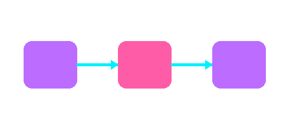

여러 종류의 콘텐츠가 글에서 어떻게 보이는지 확인하는 임시 글. `draft: true` 라서 내 컴퓨터(dev 서버)에서만 보이고 배포되지 않는다.

## 사진

### 가로로 긴 사진 (2400×1350 JPG)


### 세로로 긴 사진 (900×1400 PNG)


### 작은 그림 (480×220, 투명 배경 PNG)

원본이 본문 폭보다 작으면 늘리지 않고 원래 크기로 나온다.



## 움짤 (GIF)


## 영상 (YouTube 임베드)

<iframe
	width="560"
	height="315"
	src="https://www.youtube-nocookie.com/embed/aqz-KE-bpKQ"
	title="Big Buck Bunny"
	allow="accelerometer; encrypted-media; gyroscope; picture-in-picture"
	allowfullscreen
></iframe>

## 표

| 알고리즘 | 시간 복잡도 | 공간 복잡도 | 안정 정렬 |
|---|:---:|:---:|:---:|
| 퀵 정렬 | $O(n \log n)$ | $O(\log n)$ | ✗ |
| 병합 정렬 | $O(n \log n)$ | $O(n)$ | ✔ |
| 힙 정렬 | $O(n \log n)$ | $O(1)$ | ✗ |
| 계수 정렬 | $O(n + k)$ | $O(k)$ | ✔ |

## 수식

인라인: 피보나치 일반항은 $F_n = \frac{\varphi^n - \psi^n}{\sqrt 5}$ 이다.

블록:

$$
\sum_{k=1}^{n} k^2 = \frac{n(n+1)(2n+1)}{6}
$$

## 코드

```py ins={4} del={3}
def fib(n):
    a, b = 0, 1
    for _ in range(n): a, b = b, a + b
    for _ in range(n):
        a, b = b, a + b
    return a
```

```bash
npm run dev
```

## 기타

> 인용문은 이렇게 보인다. 두 줄 이상이면
> 이렇게 이어진다.

- [x] 끝난 일
- [ ] 남은 일

<kbd>Ctrl</kbd> + <kbd>K</kbd> 로 검색.

<details>
<summary>접힌 내용 펼치기</summary>

숨겨져 있던 내용.

</details>

---

구분선 아래 마지막 문단.
